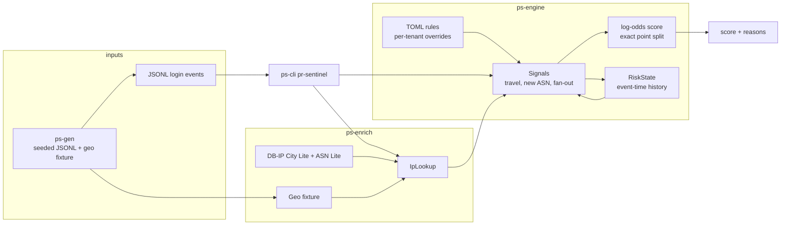

# pr-sentinel

pr-sentinel scores login attempts for account takeover, credential stuffing, and
shared or sold credentials. An IP address by itself is a weak identity:
carrier-grade NAT puts thousands of people behind one address, a VPN or a
proxy relocates a person without a new device, IPv6 privacy addresses rotate
inside a single `/64`, and DHCP gives the same laptop a new address every
morning. A rule that says "new IP means attack" fires on ordinary traffic and
misses an attacker who stays on one address and tries many accounts.

The service treats each of those facts as a weak signal. It adds them in
log-odds and returns a 0–100 score **and** the reasons that produced it. A
score without an explanation is not a result this project will emit.

This repository is milestone 1: the domain model, three detectors, DB-IP
enrichment, a seeded generator with labeled attacks, and a command-line
scorer. It uses synthetic events and the public DB-IP Lite databases. It does
not ship production logs.

Crate names use the `ps-` prefix (`ps-core`, `ps-engine`, `ps-enrich`,
`ps-gen`, `ps-cli`). The binary is `pr-sentinel`.

## Architecture



| Crate | Role |
| --- | --- |
| `ps-core` | `LoginEvent`, `IpInfo`, `SignalHit`, `RiskScore`. No I/O. |
| `ps-engine` | `Signal` implementations, in-memory history, TOML rules, scoring. No I/O. |
| `ps-enrich` | `IpLookup`: DB-IP MMDB reader, JSON fixture, and a fallback chain. |
| `ps-gen` | Seeded population with labeled impossible-travel and credential-stuffing events. |
| `ps-cli` | `generate` and `score`. |
| `ps-xtask` | `cargo xtask download-geodb`. |

Enrichment stays outside the engine. The engine scores an event plus an
`IpInfo`, so the same detectors run in unit tests, in batch replay, and later
against a stream, without opening a database. History is keyed by event time,
never by the wall clock, which is what makes a replay match a stream.

## Quickstart

Stable Rust (see `rust-toolchain.toml`). From the repository root:

```bash
cargo xtask download-geodb
cargo run -p ps-cli -- generate --seed 42 \
  --events data/logins.jsonl \
  --geo-fixture data/geo-fixture.json
cargo run -p ps-cli -- score \
  --events data/logins.jsonl \
  --city-db data/dbip-city-lite.mmdb \
  --asn-db data/dbip-asn-lite.mmdb \
  --geo-fixture data/geo-fixture.json \
  --min-score 60
```

`download-geodb` fetches the current month's DB-IP City Lite and ASN Lite
files into `data/`. They are not committed. `generate` writes RFC 5737
documentation addresses (`203.0.113.0/24`, `198.51.100.0/24`) plus a fixture
that gives each address a city and an ASN. Those addresses are not in DB-IP,
so `score` consults the databases first and falls back to the fixture. Passing
both is what the quickstart does: the MMDB files are opened (the stderr line
names their database types) and the synthetic attacks still have coordinates.

`--min-score` only filters printing. Every event is still scored, in time
order, because later decisions depend on earlier history.

The default rules live in [`rules/default.toml`](rules/default.toml). Override
the file with `--rules`.

## Sample explanation

This is the output of the quickstart above, seed 42, default rules. Stderr
reported:

```text
enrichment: DBIP-City-Lite + DBIP-ASN-Lite (compat=GeoLite2-ASN), fixture fallback (30 addresses)
scored 377 events, 25 with score >= 60
```

An ordinary home login is just the base rate. Points on this row are the whole
score:

```text
evt-000000  user-014  demo  203.0.113.24  2026-01-04T22:13:00Z  success=true
  score 5/100  probability 0.050  log-odds -2.94 -> -2.94
  prior                     5 pts  log-odds -2.94  base rate before evidence
```

Impossible travel and a new ASN, eight minutes after the user's previous
login. `5 + 66 + 26 = 97`:

```text
evt-000342  user-000  demo  203.0.113.226  2026-01-10T00:20:00Z  success=true
  score 97/100  probability 0.969  log-odds -2.94 -> +3.46
  prior                     5 pts  log-odds -2.94  base rate before evidence
  impossible_travel  +66 pts  log-odds +4.60  15889 km in 8.0 min implies 119166 km/h after subtracting 50 km and 50 km accuracy radii (limit 900 km/h)
  new_asn  +26 pts  log-odds +1.80  AS1221 (Telstra) does not appear in the previous 15 logins for this user (previously AS6167)
```

The stuffing burst is quiet until the window actually crosses a threshold,
then it alerts. The first event that reaches 8 distinct accounts, and the
last event of the burst:

```text
evt-000354  victim-07  demo  198.51.100.50  2026-01-11T00:00:07Z  success=false
  score 66/100  probability 0.658  log-odds -2.94 -> +0.66
  prior                     5 pts  log-odds -2.94  base rate before evidence
  ip_fanout  +61 pts  log-odds +3.60  198.51.100.50 reached 8 distinct accounts and 7 failures in 600s (thresholds 8 accounts, 20 failures)

evt-000376  victim-09  demo  198.51.100.50  2026-01-11T00:00:29Z  success=true
  score 98/100  probability 0.976  log-odds -2.94 -> +3.72
  prior                     5 pts  log-odds -2.94  base rate before evidence
  ip_fanout  +93 pts  log-odds +6.66  198.51.100.50 reached 20 distinct accounts and 24 failures in 600s (thresholds 8 accounts, 20 failures)
```

`--format json` prints one object per line with the same fields (`score`,
`probability`, `prior_log_odds`, `total_log_odds`, `prior_points`,
`contributions[].signal`, `log_odds`, `points`, `reason`).

## Signals

1. **Impossible travel.** Great-circle speed between this login and the user's
   immediately previous login. Each endpoint's accuracy radius is subtracted
   first, so two imprecise lookups of the same neighborhood do not look like
   a flight. Distance left after that subtraction has to clear
   `min_effective_distance_km` as well. DB-IP City Lite does not publish a
   radius; a missing radius uses `default_accuracy_radius_km` from the rules
   (50 km by default). A database that does publish a radius overrides that
   default per endpoint.
2. **New ASN.** After a few retained logins, an autonomous system this user
   has not used. The first logins are the baseline and do not fire.
3. **IP fan-out.** One source, many accounts, inside a sliding window, with a
   separate failure dimension. IPv4 is counted per address. IPv6 is counted
   per `/64`, because privacy addresses rotate inside a customer's prefix and
   a stuffing run on one prefix should not look like many sources. IPv4 is
   not collapsed: a `/24` rollup would merge unrelated customers on carrier
   NAT and invent alerts. One person mistyping a password does not fire; a
   failure burst also requires several distinct accounts.

Per-tenant overrides replace individual fields. See the comments in
`rules/default.toml`.

## Scoring and explainability

Evidence is a log-likelihood ratio. Independent signals add:

```text
L = L0 + Σ (weight_i × strength_i)
score = round(100 × σ(L))
```

`L0` is the prior, `logit(0.05)` in the default rules, which displays as 5.
`σ` is the logistic function. Travel and new-ASN are binary: strength is 1
when they fire, so the weight is the log-odds. Fan-out strength is 1 at the
threshold and grows with how far the window is past it, capped by
`strength_cap`.

Log-odds are the model. They add, they do not depend on order, and each
signal's `log_odds` is its entire contribution to `L`. The 0–100 score is
not additive, because `σ` is not linear: the same +2 log-odds moves the score
a lot near a coin flip and almost not at all when the total is already large.
That is the right probability math and a bad column to show an operator if the
columns are supposed to sum to the number on the screen.

So the score also carries an integer split. `score(L) - score(L0)` is
apportioned across the firing signals by the largest-remainder method, weighted
by their log-odds. The invariant is exact:

```text
prior_points + Σ contribution.points = score
```

The points explain the displayed number. The log-odds explain the model. They
answer different questions, and both are printed. Weights are operator policy
in the TOML file, not a fitted probability. Treating the score as a calibrated
probability would over-claim what milestone 1 knows.

Two consequences are worth keeping in view:

- Impossible travel and a new ASN often fire together, because a new city is
  usually a new network. The model adds them as if they were independent.
  That double-counts one change of place. The reasons still say which fact
  each signal saw; the weights are how loud the combination is allowed to be.
  A later milestone can put a correlation correction in the rules. Hiding
  both facts inside one detector would make the explanation worse.
- A signal's effect on the 0–100 score depends on what else fired. The point
  split is an attribution of this score, not a promise that the signal is
  "worth 66" in every context.

## State, batch, and streaming

Detectors see a `RiskView`: the previous login, the retained ASNs, and a
source's activity inside a time window. They do not update it. The engine
records the event only after every detector has run, so an event is not
evidence of itself except where fan-out explicitly counts the attempt under
evaluation.

`RiskState` is the extension point. Milestone 1 ships `MemoryState`, bounded
by a per-user cap and an IP retention window, both measured from event time.
A later Postgres store can answer the same three queries. Callers must apply
events in non-decreasing timestamp order; the engine rejects anything older
than the previous event instead of rewriting a decision it already made. The
CLI sorts a file before scoring so a shuffled export still replays cleanly.
Equal timestamps keep their input order.

## Tests

```bash
cargo fmt --all --check
cargo clippy --all-targets -- -D warnings
cargo test --workspace
```

`cargo fmt --all` is required: this is a virtual workspace.
`cargo test` passes without the MMDB files; `ps-enrich`'s DB-IP test runs
when `data/dbip-city-lite.mmdb` and `data/dbip-asn-lite.mmdb` are present and
skips otherwise. CI downloads them before `cargo test`.

Property tests cover score monotonicity, exact attribution, haversine
symmetry, and "the same coordinates are never impossible travel." The seeded
dataset test generates the default population and checks that injected attacks
score at or above 60 once they are actually visible to a detector, and that
the vast majority of unlabeled logins stay under 30.

`cargo bench -p ps-engine` runs a Criterion stub. It does not assert a timing
number. A real benchmark suite is milestone 3.

## Roadmap

**M2.** Persist `login_events` in Postgres through `sqlx`. Serve scores from
an `axum` API with an `utoipa` OpenAPI document and `tracing`.

**M3.** Device and user-agent fingerprints, time-of-day baselines, per-tenant
baselines, Tor/VPN/hosting detection (this is what fills `NetworkType`, which
the free databases leave as `Unknown`), and Criterion benchmarks.

## Data and license attribution

IP geolocation by [DB-IP](https://db-ip.com), licensed under
[CC BY 4.0](https://creativecommons.org/licenses/by/4.0/). The download task
prints the same line. Do not commit the MMDB files.

Synthetic logins use documentation addresses from RFC 5737. City coordinates
in the generator are ordinary city centers used as fixture data, not a claim
about where any real network geolocates.

## License

Licensed under either of

- Apache License, Version 2.0 ([LICENSE-APACHE](LICENSE-APACHE))
- MIT license ([LICENSE-MIT](LICENSE-MIT))

at your option.

## Contributing

See [CONTRIBUTING.md](CONTRIBUTING.md) and the [code of conduct](CODE_OF_CONDUCT.md).
Security reports go through [GitHub Security Advisories](SECURITY.md), not
public issues.
